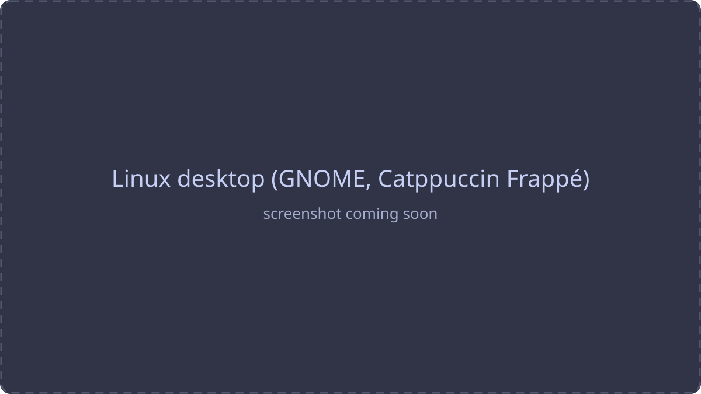
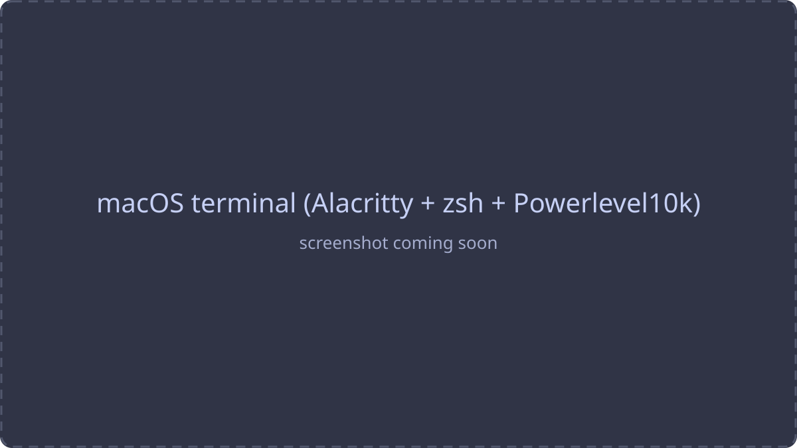
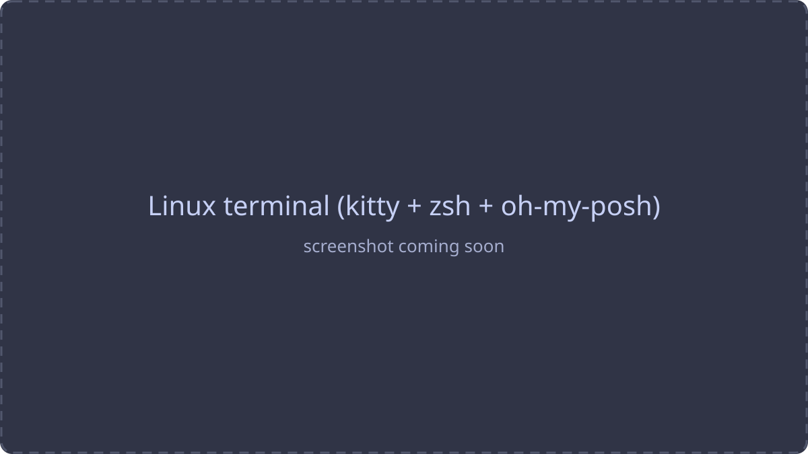
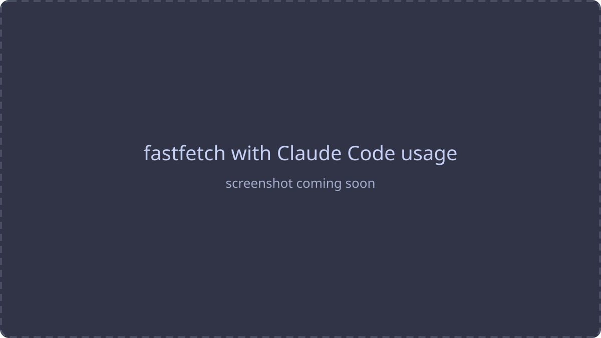

<div align="center">

# ⚙️ dotfiles

**A workflow built piece by piece. Take what you like.**

**Linux** &nbsp;·&nbsp; [Fedora](https://fedoraproject.org) · [GNOME](https://www.gnome.org) · [kitty](https://sw.kovidgoyal.net/kitty/) · [zsh](https://www.zsh.org) · [oh-my-posh](https://ohmyposh.dev) · [fastfetch](https://github.com/fastfetch-cli/fastfetch)<br>
**macOS** &nbsp;·&nbsp; [Alacritty](https://alacritty.org) · [Oh My Zsh](https://ohmyz.sh) · [Powerlevel10k](https://github.com/romkatv/powerlevel10k) · [Homebrew](https://brew.sh)<br>
**Theme** &nbsp;·&nbsp; [Catppuccin](https://catppuccin.com)

</div>

---

<p align="center">
  
  
</p>

<p align="center">
  <br>
  <sub>Catppuccin Frappé &nbsp;·&nbsp; JetBrainsMono Nerd Font &nbsp;·&nbsp; the same look on every machine</sub>
</p>

> [!TIP]
> Every setup is a few plain config files. Copy one piece or the whole thing.

> [!NOTE]
> This repo is never finished. Whatever I like ends up here.

## About

This is the setup I use every day: the terminal, the shell, the prompt and the desktop around them. I didn't write it in one go. I add a piece when something annoys me and keep it when it sticks, so it's never finished, and every part is small enough to copy on its own.

I use one Linux machine on Fedora and one Mac. The goal is that switching between them feels the same: same colors, same font, same habits in the terminal.

## Linux

Fedora with GNOME is where most of this started. The terminal is the center of it: **kitty** for speed and looks, **zsh** with a few plugins for comfort, and a minimal prompt that only shows the path and git status.

<p align="center">
  
  
</p>

<details open>
<summary><b>All parts</b></summary>

| Part | What it does |
|------|--------------|
| [kitty](linux/kitty/.config/kitty/kitty.conf) | Terminal. Catppuccin Frappé, 90% opacity, beam cursor with a trail, round powerline tabs, no window decorations, JetBrainsMono Nerd Font 14 |
| [zsh + zinit](linux/zsh/.zshrc) | Shell. Syntax highlighting, autosuggestions, completions, `fzf-tab`, plus git, sudo, kubectl and aws snippets |
| [oh-my-posh](linux/ohmyposh/.config/ohmyposh/zen.toml) | Prompt. The minimal `zen` theme: path and git status, plus user@host over SSH |
| [fastfetch](linux/fastfetch/.config/fastfetch/config.jsonc) | System info when kitty opens, with the Claude Code mascot logo and your token usage |
| [GNOME](linux/gnome/) | Catppuccin Frappé for the whole desktop |
| CLI tools | `eza`, `bat`, `fd`, `ripgrep`, `fzf`, `zoxide`, `btop`, `lazygit`, `git-delta`, `tealdeer`, `neovim`, `tmux` |
| Dev tools | Python (pip, pipx, uv), Go, Rust, gcc/make/cmake, VS Code with settings and extensions |

</details>

<details>
<summary><b>Terminal, fastfetch and GNOME details</b></summary>

### Terminal and shell

- **kitty** opens at 100×25, has 10,000 lines of scrollback and copies whatever you select to the clipboard.
- **Opacity and font on the fly:** <kbd>Ctrl</kbd>+<kbd>Shift</kbd>+<kbd>O</kbd> / <kbd>P</kbd> change opacity, <kbd>Ctrl</kbd>+<kbd>Shift</kbd>+<kbd>=</kbd> / <kbd>-</kbd> change font size, <kbd>Ctrl</kbd>+<kbd>Shift</kbd>+<kbd>Backspace</kbd> resets it.
- **History:** 5,000 entries shared between sessions, no duplicates. <kbd>Ctrl</kbd>+<kbd>P</kbd> / <kbd>N</kbd> search it by what you already typed.
- **Aliases:** `ls ll la lt` use `eza` with icons and git status, `cat` is `bat`, `lg` is lazygit, `top` is btop, `vim` is neovim, `c` clears the screen.
- **`cd` is `zoxide`:** it learns your folders, so `cd proj` jumps straight there.

### fastfetch with Claude Code usage

Opens with every new kitty window. The small `claude-usage` script reads your local Claude Code history and prints `today · week · all` token counts right in the fetch.

### GNOME desktop

The whole desktop in one look:

- Dark mode, **adw-gtk3-dark** theme, **Papirus-Dark** icons and a purple accent
- GTK3 and GTK4 apps recolored to Catppuccin Frappé ([`gtk.css`](linux/gnome/gtk.css))
- [Blur my Shell](https://extensions.gnome.org/extensions/3193/blur-my-shell/) extension, hot corners off
- Nautilus: list view, detailed dates, thumbnails always on, item counts, folders first
- "Open in Terminal" opens kitty

</details>

## macOS

The Mac follows the same ideas with that system's tools: **Alacritty**, **Oh My Zsh** and **Powerlevel10k**. **Homebrew** installs everything from a single file.

<p align="center">
  
</p>

<details>
<summary><b>All parts</b></summary>

| Part | What it does |
|------|--------------|
| [Alacritty](macos/alacritty/.config/alacritty/alacritty.toml) | Terminal. Catppuccin Frappé, blur, 95% opacity, 30px padding, JetBrainsMono Nerd Font 16, block cursor that goes hollow when unfocused |
| [zsh + Oh My Zsh](macos/zsh/.zshrc) | Shell. Plugins: git, autosuggestions, syntax highlighting, `z`, `sudo`, web-search |
| [Powerlevel10k](macos/zsh/.p10k.zsh) | Prompt. Run `p10k configure` to restyle it |
| [LinearMouse](macos/linearmouse/.config/linearmouse/linearmouse.json) | Mouse and trackpad tweaks |
| [Homebrew](macos/Brewfile) | Every CLI tool, app, font and VS Code extension I use |

</details>

<details>
<summary><b>Terminal and shell details</b></summary>

- **Alacritty:** <kbd>Shift</kbd>+<kbd>Enter</kbd> adds a new line without running the command, <kbd>Option</kbd> works as <kbd>Alt</kbd>, selected text is copied automatically.
- **Aliases:** `ls l la lla lt` use `lsd` with icons.
- **fzf** is loaded for fuzzy history, file and folder search.
- **Local settings:** machine-specific things go in `~/.zshrc.local`, which is loaded if it exists and never committed.
- **`claude` helper:** typing `claude` from your home folder starts Claude Code in `~/projects/work` instead.

</details>

## Shared

The parts that don't care which system they run on: the monitor, the editor settings, the Claude Code themes and the wallpapers.

<details>
<summary><b>All parts</b></summary>

| Part | What it does |
|------|--------------|
| [btop](shared/btop/.config/btop/btop.conf) | System monitor, a `top` replacement |
| [VS Code](shared/vscode/settings.json) | One Dark Pro Night Flat, Material icons, JetBrainsMono Nerd Font (Fira Code as fallback), no minimap, compact auto-hiding activity bar |
| [Claude Code themes](shared/claude-themes/) | 7 themes: Catppuccin Frappé and Mocha, Tokyo Night, Kanagawa, Gruvbox, Rosé Pine, Dracula. Pick one with `/theme` |
| [bash](shared/bash/.bashrc) | A tiny fallback that loads fzf |

</details>

## 🖼️ Wallpapers

Wallpapers and their credits live in [`wallpapers/`](wallpapers/).

## ⌨️ Shortcuts

All my keys and aliases on one page: [`docs/SHORTCUTS.md`](docs/SHORTCUTS.md).

---

## 📁 Structure

```
dotfiles/
├── macos/          Brewfile, zsh + Powerlevel10k, Alacritty, LinearMouse
├── linux/          kitty, zsh, oh-my-posh, fastfetch, GNOME
├── shared/         btop, VS Code, Claude Code themes, bash
├── wallpapers/     backgrounds and credits
└── docs/           shortcuts and screenshots
```

## 🔒 Secrets

No passwords, tokens or keys live in this repo. Private or machine-specific settings go in `~/.zshrc.local`, which git ignores.

---

<div align="center">
<sub>Made by <a href="https://github.com/Hat-7380">@Hat-7380</a> · feel free to borrow anything</sub>
</div>
