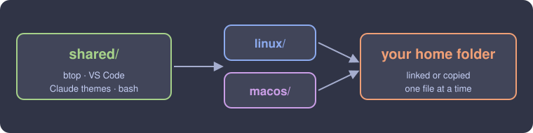

# ⚙️ dotfiles

**A workflow built piece by piece. Take what you like.**

**Linux** &nbsp;·&nbsp; [Fedora](https://fedoraproject.org) · [GNOME](https://www.gnome.org) · [kitty](https://sw.kovidgoyal.net/kitty/) · [zsh](https://www.zsh.org) · [oh-my-posh](https://ohmyposh.dev) · [fastfetch](https://github.com/fastfetch-cli/fastfetch) 
**macOS** &nbsp;·&nbsp; [Alacritty](https://alacritty.org) · [Oh My Zsh](https://ohmyz.sh) · [Powerlevel10k](https://github.com/romkatv/powerlevel10k) · [Homebrew](https://brew.sh) 
**Theme** &nbsp;·&nbsp; [Catppuccin](https://catppuccin.com)

---

  
  

   
  Catppuccin Frappé &nbsp;·&nbsp; JetBrainsMono Nerd Font &nbsp;·&nbsp; the same look on every machine

> [!TIP]
> Every setup is a few plain config files. Copy one piece or the whole thing.

> [!NOTE]
> Linux is the main part of this repo. macOS is small on purpose.

## About

This is the setup I use every day. Linux is where I experiment the most: different distros, different desktops and window managers, and every part of them, from the lock screen to the launcher. The Mac is simple: a terminal and the apps I use.

Each part comes with a short reason: why I chose it and how much it matters to me.

## Linux

My main playground. Here is what I've customized, by environment and by part.

| Environment | Main screen | Top bar | Launcher | Lock screen |
|-------------|:-----------:|:-------:|:--------:|:-----------:|
| [GNOME](#gnome) | **done** | planned | planned | planned |
| KDE Plasma | planned | planned | planned | planned |
| i3 | planned | planned | planned | planned |
| Hyprland | planned | planned | planned | planned |

Top bar means the panel or waybar. Launcher means rofi or dmenu. More parts get added as I finish them.

### GNOME

Catppuccin Frappé on the whole desktop with Papirus icons and Blur my Shell. *Why: it's the desktop I use daily, so it gets the most polish.*

  

<b>All parts</b>

| Part | What it does |
|------|--------------|
| [GTK theme](linux/gnome/gtk.css) | Recolors GTK3 and GTK4 apps to Catppuccin Frappé |
| [Desktop settings](linux/gnome/apply.sh) | Dark mode, **adw-gtk3-dark** theme, **Papirus-Dark** icons, purple accent, hot corners off |
| [Blur my Shell](https://extensions.gnome.org/extensions/3193/blur-my-shell/) | Blurred panel and overview |
| Nautilus | List view, detailed dates, thumbnails always on, item counts, folders first, "Open in Terminal" opens kitty |

### KDE Plasma · i3 · Hyprland

*Planned. These get their own sections as soon as they're ready.*

### Terminals

kitty is set up on Linux. Alacritty is configured on macOS, and its Linux version is planned. *Why: the terminal is where I spend most of my time.*

  

<b>All parts</b>

| Part | What it does |
|------|--------------|
| [kitty](linux/terminals/kitty/.config/kitty/kitty.conf) | Catppuccin Frappé, 90% opacity, beam cursor with a trail, round powerline tabs, no window decorations, JetBrainsMono Nerd Font 14 |
| Alacritty | Planned for Linux |

<b>kitty details</b>

- Opens at 100×25, has 10,000 lines of scrollback and copies whatever you select to the clipboard.
- **Opacity and font on the fly:** <kbd>Ctrl</kbd>+<kbd>Shift</kbd>+<kbd>O</kbd> / <kbd>P</kbd> change opacity, <kbd>Ctrl</kbd>+<kbd>Shift</kbd>+<kbd>=</kbd> / <kbd>-</kbd> change font size, <kbd>Ctrl</kbd>+<kbd>Shift</kbd>+<kbd>Backspace</kbd> resets it.

### Shell and prompt

zsh with zinit plugins and the minimal oh-my-posh prompt. *Why: fast to start and shows only what I need.*

  

<b>All parts</b>

| Part | What it does |
|------|--------------|
| [zsh + zinit](linux/shell/zsh/.zshrc) | Syntax highlighting, autosuggestions, completions, `fzf-tab`, plus git, sudo, kubectl and aws snippets |
| [oh-my-posh](linux/shell/ohmyposh/.config/ohmyposh/zen.toml) | The minimal `zen` prompt: path and git status, plus user@host over SSH |
| [fastfetch](linux/shell/fastfetch/.config/fastfetch/config.jsonc) | Runs when kitty opens, with the Claude Code mascot logo and your token usage |
| CLI tools | `eza`, `bat`, `fd`, `ripgrep`, `fzf`, `zoxide`, `btop`, `lazygit`, `git-delta`, `tealdeer`, `neovim`, `tmux` |
| [Dev tools](linux/dev-setup.sh) | Python (pip, pipx, uv), Go, Rust, gcc/make/cmake, VS Code with settings and extensions |

<b>Shell details</b>

- **History:** 5,000 entries shared between sessions, no duplicates. <kbd>Ctrl</kbd>+<kbd>P</kbd> / <kbd>N</kbd> search it by what you already typed.
- **Aliases:** `ls ll la lt` use `eza` with icons and git status, `cat` is `bat`, `lg` is lazygit, `top` is btop, `vim` is neovim, `c` clears the screen.
- **`cd` is `zoxide`:** it learns your folders, so `cd proj` jumps straight there.
- **fastfetch:** the small `claude-usage` script reads your local Claude Code history and prints `today · week · all` token counts right in the fetch.

### Apps

*Planned. The apps I customize on Linux, with their configs.*

### Distros

Fedora today. Other distros get their package lists and notes here.

## macOS

Just two things: the terminal and the apps I use.

### Terminal and tools

Alacritty with zsh, Oh My Zsh and Powerlevel10k. kitty is coming soon. *Why: same look as Linux, nothing more.*

  

<b>All parts</b>

| Part | What it does |
|------|--------------|
| [Alacritty](macos/terminal/alacritty/.config/alacritty/alacritty.toml) | Catppuccin Frappé, blur, 95% opacity, 30px padding, JetBrainsMono Nerd Font 16, block cursor that goes hollow when unfocused |
| [zsh + Oh My Zsh](macos/terminal/zsh/.zshrc) | Plugins: git, autosuggestions, syntax highlighting, `z`, `sudo`, web-search |
| [Powerlevel10k](macos/terminal/zsh/.p10k.zsh) | The prompt. Run `p10k configure` to restyle it |

- **Alacritty:** <kbd>Shift</kbd>+<kbd>Enter</kbd> adds a new line without running the command, <kbd>Option</kbd> works as <kbd>Alt</kbd>, selected text is copied automatically.
- **Aliases:** `ls l la lla lt` use `lsd` with icons. **fzf** is loaded for fuzzy history, file and folder search.
- **Local settings:** machine-specific things go in `~/.zshrc.local`, which is loaded if it exists and never committed.
- **`claude` helper:** typing `claude` from your home folder starts Claude Code in `~/projects/work` instead.

### Apps I use

The ones I use the most and the ones I find useful. *Why: easy to see what's worth installing.*

<b>All parts</b>

| Part | What it does |
|------|--------------|
| [Homebrew Brewfile](macos/apps/Brewfile) | Every CLI tool, app, font and VS Code extension I use |
| [LinearMouse](macos/apps/linearmouse/.config/linearmouse/linearmouse.json) | Mouse and trackpad tweaks |

## Shared

A few small files used on both systems. Each folder mirrors your home folder, so you can link one or copy the file you want.

  

<b>All parts</b>

| Part | What it does |
|------|--------------|
| [btop](shared/btop/.config/btop/btop.conf) | System monitor, a `top` replacement |
| [VS Code](shared/vscode/settings.json) | One Dark Pro Night Flat, Material icons, JetBrainsMono Nerd Font (Fira Code as fallback), no minimap, compact auto-hiding activity bar |
| [Claude Code themes](shared/claude-themes/) | 7 themes: Catppuccin Frappé and Mocha, Tokyo Night, Kanagawa, Gruvbox, Rosé Pine, Dracula. Pick one with `/theme` |
| [bash](shared/bash/.bashrc) | A tiny fallback that loads fzf |

No passwords, tokens or keys live in this repo. Private or machine-specific settings go in `~/.zshrc.local`, which git ignores.

## Wallpapers and shortcuts

Wallpapers and their credits live in [`wallpapers/`](wallpapers/). All my keys and aliases are on one page: [`docs/SHORTCUTS.md`](docs/SHORTCUTS.md).

---

Made by <a href="https://github.com/Hat-7380">@Hat-7380</a> · feel free to borrow anything

